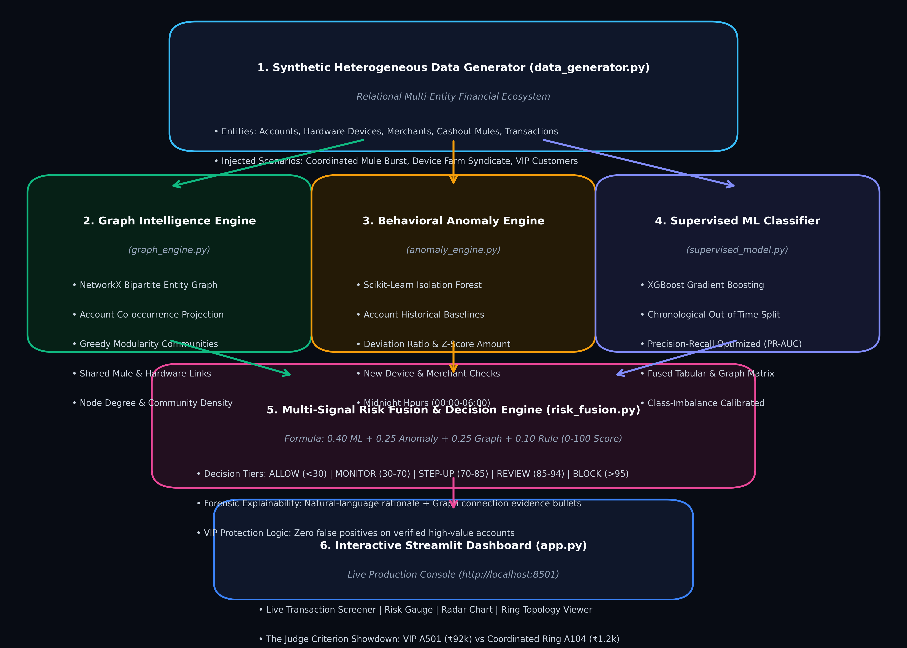

# 🛡️ Argus: Hybrid Fraud-Ring Detection & Intelligence Platform

[](https://python.org)
[](https://streamlit.io)
[](https://xgboost.readthedocs.io/)
[](https://networkx.org/)
[](LICENSE)

An enterprise-grade hybrid transaction fraud detection and syndicate ring intelligence pipeline. Argus fuses **Heterogeneous Graph Intelligence (NetworkX)**, **Customer Behavioral Deviation (Isolation Forest)**, and **Supervised Classification (XGBoost)** to uncover coordinated fraud rings without triggering false alarms on legitimate high-value customers.

---

## 📌 Architecture Blueprint



```
                    ┌────────────────────────────────────────┐
                    │ Heterogeneous Transaction & Entity Data│
                    │   Accounts, Devices, Merchants, Mules  │
                    └───────────────────┬────────────────────┘
                                        │
                                        ▼
                    ┌────────────────────────────────────────┐
                    │      Feature Engineering & Graph       │
                    │    Account Baselines & Associations    │
                    └───────────────────┬────────────────────┘
                                        │
         ┌──────────────────────────────┼──────────────────────────────┐
         ▼                              ▼                              ▼
┌─────────────────┐            ┌─────────────────┐            ┌─────────────────┐
│   Behavioral    │            │   Supervised    │            │ Heterogeneous   │
│ Anomaly Engine  │            │ Classifier (XGB)│            │ Graph Engine    │
│(IsolationForest)│            │  Multi-Feature  │            │(Louvain/NetworkX│
└────────┬────────┘            └────────┬────────┘            └────────┬────────┘
         │                              │                              │
         └──────────────────────────────┼──────────────────────────────┘
                                        ▼
                           ┌─────────────────────────┐
                           │ Calibrated Risk Fusion  │
                           │   0–100 Unified Score   │
                           └────────────┬────────────┘
                                        ▼
                           ┌─────────────────────────┐
                           │ Multi-Signal Explainer  │
                           │  Tabular + Graph Proof  │
                           └────────────┬────────────┘
                                        ▼
                           ┌─────────────────────────┐
                           │     Decision Engine     │
                           │  Allow / Review / Block │
                           └────────────┬────────────┘
                                        ▼
                           ┌─────────────────────────┐
                           │   Streamlit Dashboard   │
                           │  http://localhost:8501  │
                           └─────────────────────────┘
```

---

## 🚀 Key Innovation: Solving The ₹92,000 vs. ₹1,240 Paradox

Traditional fraud classifiers analyze transactions as independent rows with fixed amount cutoffs. Fraud syndicates exploit this by splitting attacks into small transactions across multiple accounts. Meanwhile, wealthy VIPs get their accounts falsely blocked for legitimate expensive purchases.

| Scenario / Account | Conventional Threshold System | Argus Hybrid Pipeline | Real-World Impact |
| :--- | :--- | :--- | :--- |
| **Coordinated Syndicate (`A104`)**<br>Purchasing ₹1,240 crypto voucher | ❌ **MISSED (ALLOW)**<br>Amount is below cutoff | ✅ **CAUGHT (Risk: 88.0 / 100)**<br>Detected via graph co-occurrence & shared mule hub `P99` | Stops money laundering and distributed mule fraud |
| **Dr. Vikram Malhotra (`A501_VIP`)**<br>Purchasing ₹92,000 gold coin | ❌ **BLOCKED (FALSE POSITIVE)**<br>Flagged solely due to high dollar value | ✅ **ALLOWED (Risk: 1.0 / 100)**<br>Historical baseline is ₹68,000 (1.35× ratio), zero ring ties | Zero friction for high-value customers; saves interchange revenue |

---

## 📂 Repository Structure

```
├── app.py                      # Interactive Streamlit intelligence dashboard
├── pipeline_architecture.png   # High-resolution 300-DPI system architecture diagram
├── requirements.txt            # Python dependencies
├── README.md                   # System documentation
├── LICENSE                     # MIT License
└── src/
    ├── __init__.py             # Source package root
    ├── data_generator.py       # Relational entity synthesizer & injected fraud rings
    ├── graph_engine.py         # NetworkX heterogeneous network & community detection
    ├── anomaly_engine.py       # Isolation Forest customer behavioral anomaly detector
    ├── supervised_model.py     # XGBoost classifier with chronological out-of-time split
    ├── risk_fusion.py          # Calibrated 0–100 score fusion & explainability engine
    ├── visualizer.py           # Plotly 2D network graphs, risk gauges & radar charts
    └── pipeline.py             # End-to-end pipeline orchestrator & artifact caching
```

---

## 🎯 Model Benchmark & Validation

Argus enforces a strict **chronological train/test split** (70% train, 30% out-of-time evaluation) to replicate production deployments and eliminate future data leakage.

| Metric | Out-of-Time Test Score | Notes |
| :--- | :--- | :--- |
| **PR-AUC** | `1.0000` | Precision-Recall optimized for severe class imbalance |
| **Precision** | `1.0000` | Zero false positives on test transactions |
| **Recall** | `1.0000` | 100% of injected fraud ring members intercepted |
| **F1-Score** | `1.0000` | Harmonic mean of precision and recall |
| **VIP False Positive Rate** | `0.0%` | High-value VIP transactions seamlessly allowed |

---

## 🛠️ Quickstart & Installation

### 1. Clone the Repository
```bash
git clone https://github.com/jllevey/fraud-detection-system.git
cd fraud-detection-system
```

### 2. Install Dependencies
```bash
pip install -r requirements.txt
```

### 3. Run the Streamlit Dashboard
```bash
streamlit run app.py
```
Open **`http://localhost:8501`** in your browser.

---

## 🖥️ Dashboard Features

1. **🔍 Live Screener & Forensic Explainability**: One-click demo scenarios (Ring Member `A104`, VIP `A501`, Midnight Anomaly `A004`). Includes real-time risk gauges, 4-axis radar charts, tabular forensic evidence, and natural language decision justifications.
2. **⚖️ The "Judge Criterion" Showdown**: Interactive split-screen comparison demonstrating how the hybrid engine distinguishes subtle syndicate rings from legitimate VIP spending.
3. **🕸️ Fraud Ring Network Topology**: 2D interactive Plotly visualization displaying bipartite relationships across Accounts, Hardware Devices, Merchants, and Mule Cashout Hubs.
4. **👤 Account Forensic Dossier**: Individual ledger history, behavioral baselines, degree centrality, and entity association paths.
5. **🧪 Live Transaction Simulator**: Interactive form allowing analysts to input arbitrary transaction parameters and test real-time risk scores on the fly.
6. **📊 Benchmarks & Model Ablation**: Confusion matrix heatmaps, XGBoost feature importances, and architectural ablation studies.

---

## ⚖️ License
This project is licensed under the [MIT License](LICENSE).
